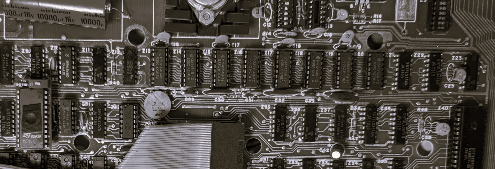

 

# Kid-Phone

These are my notes on building a Kid-Phone. 

This started when I found this article that let me to build this interesting project.
I then create the 3d phone to house the components.

https://muonsortes.com/toddler-phone#using

This is the github site for the current release:
https://github.com/AllanBinder/kid-phone

So the install you have several options listed on the site and you can use this ESP32 Install tool:
https://allanbinder.github.io/kid-phone/

## 📂 Content in repository

        .
	├── 3d                                  		- STL for the Kid-Phone I created
	├── 3d\retroPhoneKid-phone-Bottom.stl			- Phone bottom plate stl
	├── 3d\retroPhoneKid-phone-SPI32Cover.stl       - Phone cover for the ESP32-S3 stl
	├── 3d\retroPhoneKid-phone-Top.stl				- Phone Top stl
	├── 3d\retroPhoneKid-phone.3mf					- All 3 parts arranged to print well
	└── images                              		- Location for images used for this repo's README.md files

 

<table>
  <tr>

    <td>  Front of the phone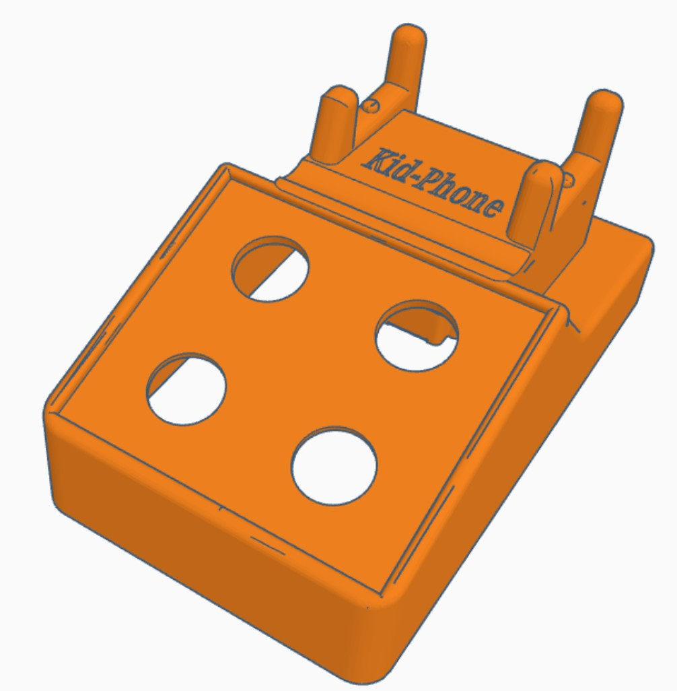</td>
    <td>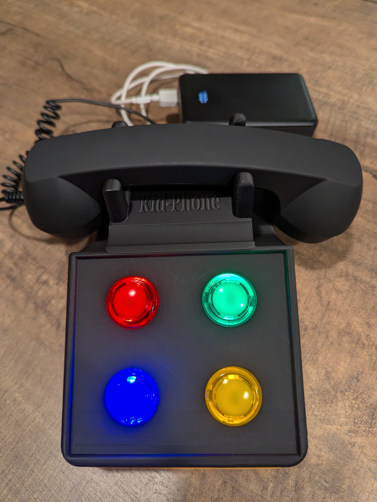</td>
  </tr>
  <tr>
    <td>  Back of the phone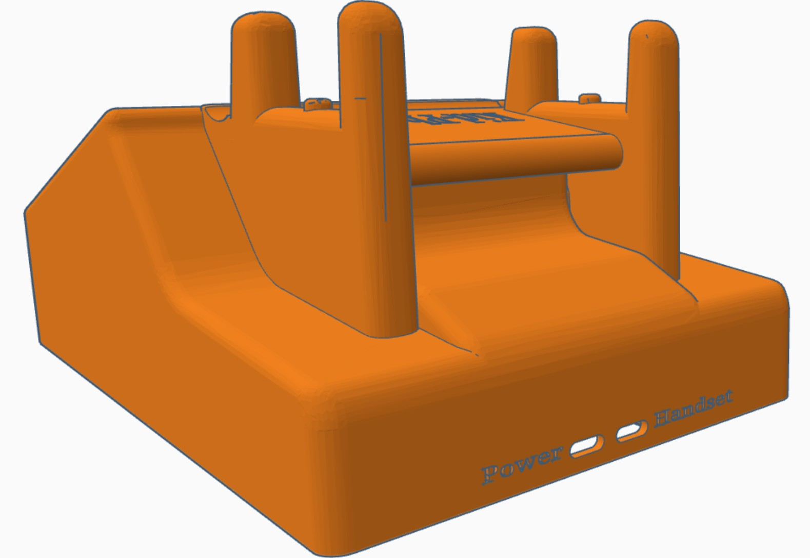</td>
    <td>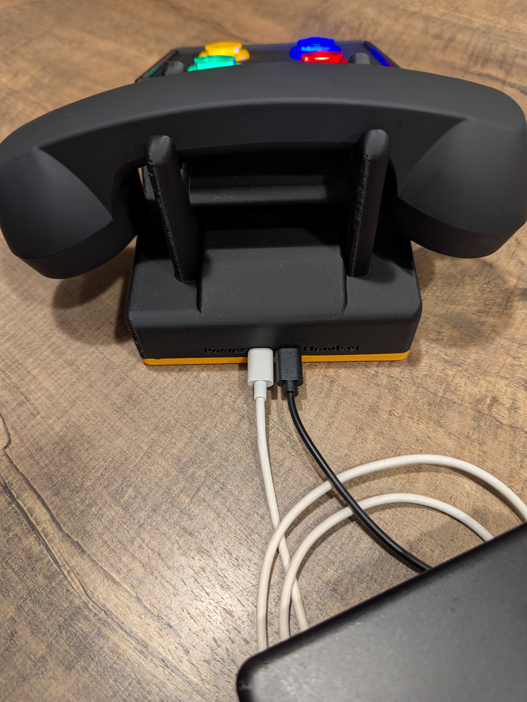</td>
  </tr>
  <tr>
    <td>  Bottom of the phone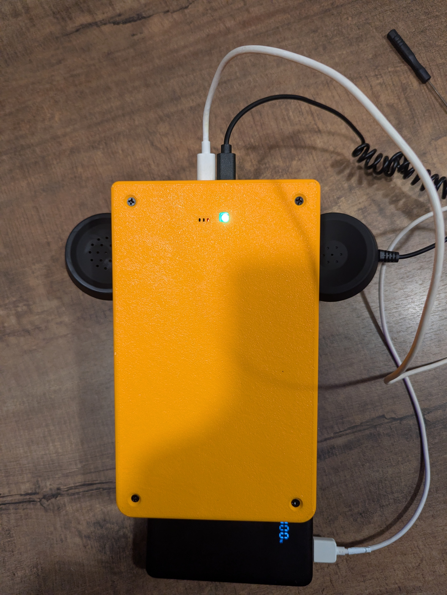</td>
  </tr>
  <tr>
    <td>  Wiring sampes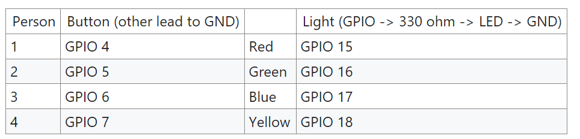<td>
    <td>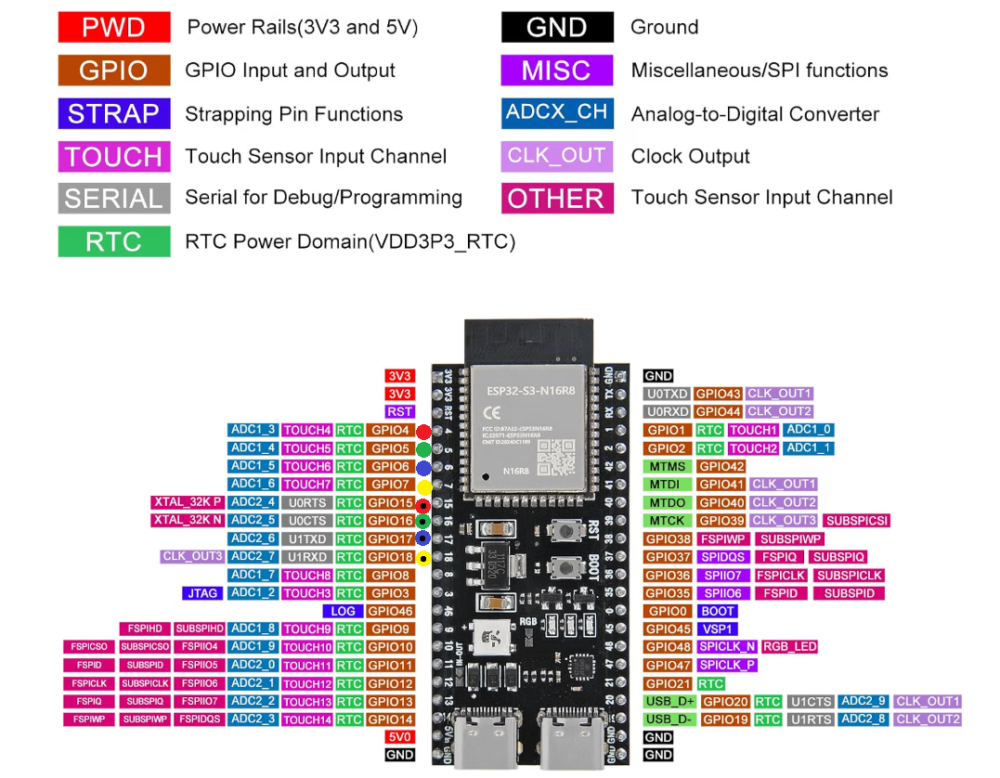</td>
  </tr>
  <tr>
    <td>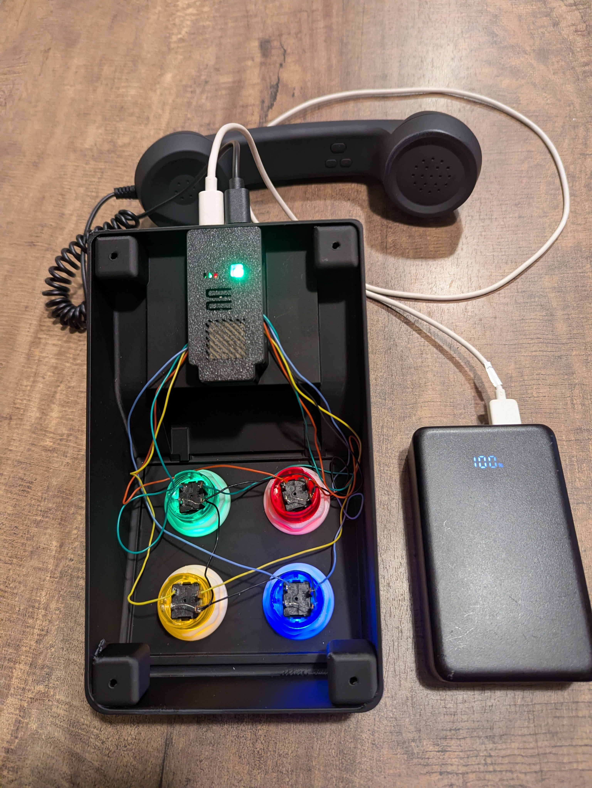</td>
  </tr>                                        
</table>
 

Local Web config URL to config the Kid-Phone ESP32  
http://kidphone.local/

##Parts purchased 

ESP32-S3: https://www.amazon.com/dp/B0CKXJLP4B
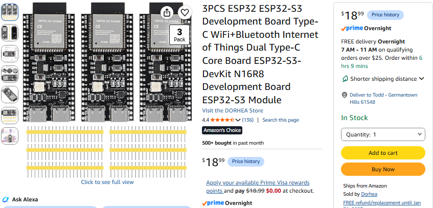

Button: https://www.amazon.com/dp/B07L3XF6V9
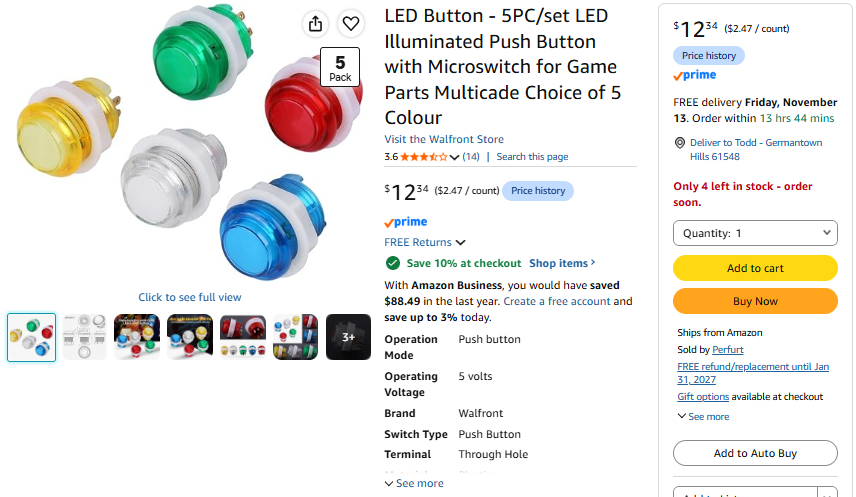
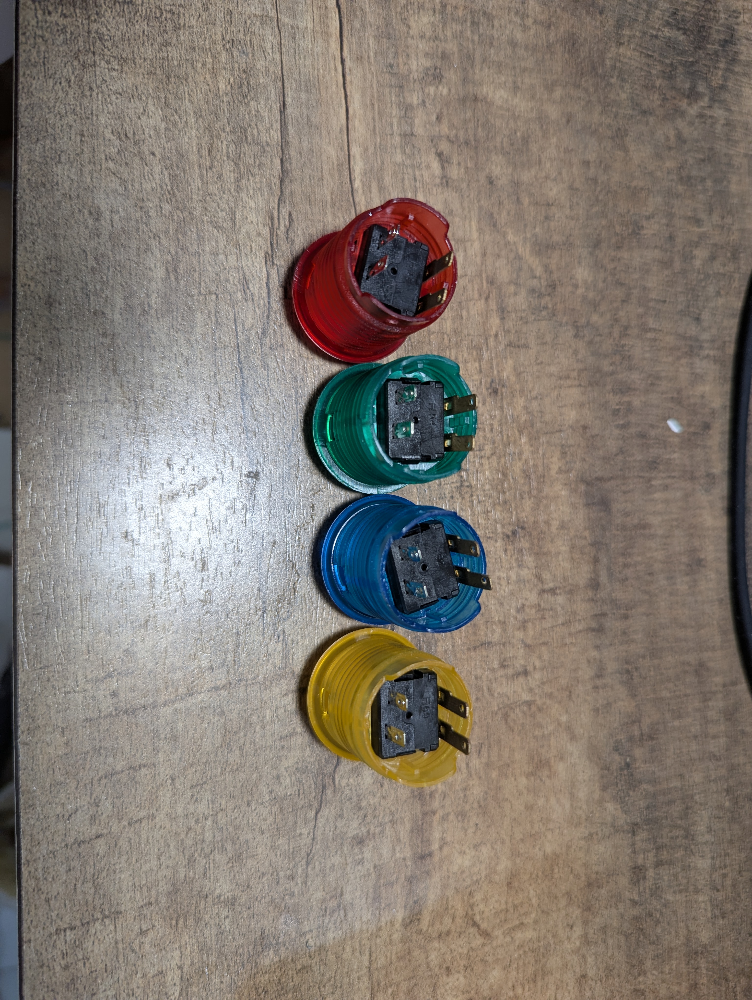</td>

